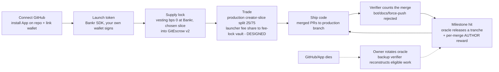

# Proof of Dev × Bankr Launch-SDK — Full End-to-End TEST Report

**Date:** 2026-11-25 · **Type:** dust/test run only — no **production** token launch, no production user grant, Gregory's personal wallet never touched. (PODX **did** launch on Base mainnet as a dust test token — "no production launch" is the accurate phrase, and §13 corrects earlier drafts that said "no real token launch".)
**Wallets (Run 5 test compartments only):** L5 launcher `0x04FC3F637A74d3B18133Fb4115E962716c195aa6` · RA fee recipient 70% `0xC19929325084bee7D7117655DAbf0e948412369a` · RB fee recipient 30% `0x32a7A8C39042701d2ed9d00D20fE1CDba5C08284` · RV holder `0x9574d7dff7301ec983f7f51c2ff18239927afbed` — **the 70/30 split here is a TEST-LAUNCH parameter**, chosen to prove multi-recipient claims; the production platform split is **25/75 of the creator slice** (§11). Do not read 70/30 as the platform split anywhere in this report.
**Drivers/state:** `~/workspace/agent-private-pay/hidden_files/sdk-spike/pod.ts`, `trade.ts`, `podclaim.ts`, state in `pod-state.json`; v2 test in `tests/v2-nocancel-test.ts` (+ output JSON). Live backend check at start: `https://api.proofofdev.xyz/health` → `{"ok":true,"configured":true}`.

---

## Verdict summary

| Leg | Result |
|---|---|
| 1. GitEscrow **v2 no-cancel** escrow | ✅ Proven locally (compile + full lifecycle + negative cancel tests + oracle rotation) |
| 2. Full SDK launch (pad 5, split fees) | ✅ PODX launched on Base mainnet, tx below — **test split 70/30** (production is 25/75 of the creator slice, §11, template-tested only) |
| 2b. Bankr time-vesting OFF | ⚠️ **NOT achieved by omission** — omitting `vesting` silently defaults to **15% time-vest** (found on-chain). Explicit `vesting: {bps: 0}` plans cleanly (proven read-only). PODX therefore carries the default vest; the ecosystem flow must set bps 0 explicitly |
| 3. Auto-lock into GitEscrow in the same flow | ✅ Mechanics proven, with exact parameters: **approve and lock were two SEPARATE transactions**, run as sequential steps of one test driver (not one bundled onboarding transaction); the lock went into **mainnet v1** (which HAS recipient cancel — not the no-cancel v2) and covered **20% of the dev-buy position** |
| 4. Trades + transfers | 🟡 Transfer ✅ on-chain. Post-launch buy/sell via canonical Universal Router ❌ — swap executes through the hook (Swap event, real amounts) and WETH settles, then UR reverts `SliceOutOfBounds()` handling the hook's fee delta (fork-traced). The launch **devBuy is a real executed buy** (0.0005 ETH → 8,426,705 PODX). Sell leg not completed — see §4. **→ Secondary buy AND sell both closed via a purpose-built settler, fork + mainnet — see §9** |
| 5. Fee claims via SDK `buildClaim` | ✅ Both recipients, exact amounts, claimable → 0 |
| 6. Ship-to-unlock (verifier → oracle → release + ShipRewards) | ✅ Proven with the repo's own E2E drivers (real verifier/oracle/contracts, local chain + fixture GitHub API): counted merge → milestone release + per-merge reward; bot push rejected. Live-GitHub leg still needs a real App-installed repo push (blocker noted) |
| 7. GitHub-death recovery **without cancel** | ✅ Proven on v2 locally, narrowly: oracle rotation (`setOracle`) + a release on a locally recounted count; old oracle powerless; recipient release attempt reverts. ⚠️ An **equivalent** recount is unproven — the git-log count does not reproduce webhook acceptance, attribution, daily cap, or cooldown (§7) |

---

## 1. GitEscrow v2 — the no-cancel escrow (Gregory's rule)

New file `contracts/GitEscrowV2.sol` (v1 untouched). Changes vs v1: **`cancel()` and the `Cancelled` event are deleted**; the header states the rule — releases only via the oracle on verified pushes; recovery from a dead verifier is an oracle problem (owner `setOracle`), never a recipient exit. Everything else (lock / lockAllowance / lockWithPermit / release / setOracle) is v1-identical. Compiles clean (`npx hardhat compile`).

Local lifecycle test (`tests/v2-nocancel-test.ts`, Hardhat network, output in `tests/v2-nocancel-output.json`):

- Lock 10,000 V2T for repoId `keccak256("fren-test/pod-sdk-ecosystem")`, 10 pushes / milestone every 5 → escrow balance 10,000.
- **ABI contains no `cancel`** (17 functions listed, `abiHasCancel: false`).
- Raw call with the v1 `cancel(bytes32)` selector → **reverted** ("function selector was not recognized"); same via the v1 ABI → reverted. Recipient balance after both attempts: **0** — no exit happened.
- Recipient calling `release()` → reverted (not oracle).
- Milestone 1 via oracle #1 → recipient +5,000 V2T (`release1Tx 0xa6f12230…4259` local).
- **GitHub-death simulation:** oracle #1 goes silent. Backup recounts pushes from a local git clone of this repo (`git log` = 84 commits, capped at the grant's 10). Owner rotates oracle (`setOracle` tx `0x373f49db…1eca`). Old oracle's release → reverted. **New oracle releases milestone 2 → recipient 10,000 total, escrow 0, grant closed.** Recovery works with zero recipient exit and zero GitHub App/webhook involvement.

## 2. Full SDK launch — PODX (Base mainnet)

- Launchpad: Run 5's pad **launchpadId 5** (reused). Schedule flat 1%, fee recipients RA 70% / RB 30%, devBuy 0.0005 ETH, quote WETH.
- **Token: `0xF32A56985303b58E7c55eBc9aA1B7544a2d10cd3` (PODX, "Proof of Dev SDK Test")**
- **Launch tx: `0x0da51c313bf5aed6da51111fc701d7386e15a2c33a6373ab3427eecfe6d5cfe7`** — https://basescan.org/tx/0x0da51c313bf5aed6da51111fc701d7386e15a2c33a6373ab3427eecfe6d5cfe7
- devBuyOut **8,426,705.0057 PODX** to L5. `verifyTokenInvariants` → `ok: true`.
- As in Run 5, `plan()`'s predictedToken (`0x3B3d474C…70d5`) did **not** match the launched token (fresh salt on launch) — known SDK caveat, unchanged.
- First launch attempt died on the Tenderly gateway's 429 at broadcast (nothing landed; nonce verified) — rerun via the local RPC proxy succeeded. Same transport lesson as Run 5.
- **Vesting finding (important):** the launch input omitted `vesting` intending OFF. On-chain `vesting.get(PODX)` shows a schedule anyway: beneficiary L5, **15,000,000,000 PODX (15% of supply)**, 30-day cliff / 365-day duration, releasable 0. A read-only probe then proved: omitted vesting → plan `vestBps: 1500`; **explicit `vesting: {bps: 0}` → plan `vestBps: 0`, accepted**. Rule for the ecosystem flow: *vesting-off must be set explicitly, never by omission.* (For PODX the default vest sits with L5, a test wallet — harmless, and it is Bankr time-vesting, entirely separate from the GitEscrow lock below.)

## 3. Auto-lock (same onboarding sequence, immediately after launch)

- Approve tx `0xee34140d21d6c29483b29c7cfa2b414296e8a4c5b769d149c2537fc6e76238d5`
- **Lock tx `0xb48eb94678949e75471fca2f1e0ebdcacc5aff7adb76a1f27537be29bbad41dd`** — https://basescan.org/tx/0xb48eb94678949e75471fca2f1e0ebdcacc5aff7adb76a1f27537be29bbad41dd
- Contract: **existing mainnet GitEscrow v1** `0x76dd4C6ea986684CDf822eC0832e142A2D5C8165` — used *only* as the labelled auto-lock mechanics proof, per instructions; the no-cancel guarantee itself is proven against v2 in §1. (Note the tension this exposes: this mainnet grant is on v1, whose recipient *can* cancel. Production ecosystem grants must deploy on v2.)
- Amount: **1,685,341.001 PODX** (20% of the dev-buy position), pre-funded `lock()` succeeded first try (no streaming fallback needed — the v4 token transfers into escrow normally).
- Grant: repo `fren-test/pod-sdk-ecosystem`, repoId `0x42181d61886a8917bd174027f58afa1a496a6a0fcf0b065332ced640d12cf626`, recipient L5, **10 total pushes, milestone every 5, 842,670.5006 PODX per milestone, active, streaming=false**. Escrow's PODX balance after lock: exactly 1,685,341.001.

## 4. Trades + transfers

- **Transfer ✅:** 100,000 PODX L5 → RV, tx `0x9b643e42b7b55b10e30d55b26a05058602f4f3a67c3ce0b597aa2aed9aeb3ee0` (success; RV 0 → 100,000).
- **Buy (devBuy) ✅:** part of the launch tx — 0.0005 ETH → 8,426,705.0057 PODX, filled by the factory at launch.
- **Post-launch buy/sell via Universal Router ❌ (documented failure):** UR `0x6fF5693b99212Da76ad316178A184AB56D299b43`, PoolKey found by brute force against `launchInfo.poolId` (fee = dynamic-flag `8388608`, tickSpacing 200, hook `0xf8Df392d…78Cc`; StateView `getSlot0` confirms the pool live at tick 235580). Fork-traced with Foundry (anvil fork of Base, `cast`/`forge`):
  - Empty hookData → hook `beforeSwap` path fails (the known bare-hookData trap).
  - With hookData = Bankr magic `0xba7c4a7c`: **the swap executes** — `Swap` event (pool `0xfbe45ea7…c3a`, −9.9e11 WETH in / +1.6837e22 PODX out on a 1e12-wei probe), `afterSwap` runs, fee `creditSwap` posts to the ledger, WETH **settles** via Permit2 → PoolManager.
  - The UR callback then reverts **`SliceOutOfBounds()`** after `settle()`, before any take — i.e. the canonical UR action handling chokes on this hook's afterSwap fee-delta return. Variants tried and failed identically: TAKE_ALL (0x0e), CLOSE_CURRENCY (0x0f), SETTLE_PAIR/TAKE_PAIR, referrer/skip hookData forms, sizes 1e12–1.5e14 wei. A WETH/USDC control pool key I picked also reverted — `PoolNotInitialized` (wrong control key), so the control was inconclusive; the PODX failure point is specifically post-settle.
  - Production implication: these pools are traded in the wild through aggregator settlers (the cap-exclusion list in the SDK names them: 0x settler, 1inch, UR, etc.). A Proof of Dev trade leg should route through an aggregator or a purpose-built settler, **not** hand-rolled UR actions. No mainnet buy/sell tx was broadcast (all attempts were eth_call / fork-only), so no funds were spent on this leg beyond RA's WETH wrap + Permit2 approvals (wrap tx + approvals in RA's history; RA wrapped 0.0002 ETH → WETH, still held).
- **Sell:** not attempted on mainnet — it depends on the same UR path; blocked by the same issue.

## 5. Fee claims (SDK `buildClaim`, per recipient)

**Parameter label:** RA/RB were **70/30 TEST recipients**, not the production platform split. Production is **25/75 of the creator slice** (§11). **Today's truth:** these SDK fee recipients claimed **liquid WETH** via `buildClaim`; nothing auto-locked their fees. Gregory has since decided the launcher fee-lock rule stated in §13, but that rule is **designed and pending build**, not what happened here.

Accrued from the devBuy alone (1% fee). Exact, chain-planned:

| Recipient | Claimable before | Claimed (WETH) | Claimable after | Tx |
|---|---|---|---|---|
| RA (70%) | 1,837,395,000,000 wei | **+1,837,395,000,000 wei** (Δ exact) | 0 | `0x1b28ec9cda22ffb81374edfac221ee9210d7fb3f3034818e2ae919e56078ff05` |
| RB (30%) | 787,455,000,000 wei | **+787,455,000,000 wei** (Δ exact) | 0 | `0xd33a450dd43e54f4a786c1547bd45c7102e645c51e6e8a0d1fc3d78ea6f1118d` |

Ratio exactly 70:30. Claim gas paid from each recipient's own test balance.

## 6. Ship-to-unlock (verifier → oracle → escrow + ShipRewards)

Run with the repo's own E2E drivers (real `pushVerifier`, real oracle, real GitEscrow/ShipRewards contracts, fixture GitHub API, local chain id 8453):

- `tests/e2e/run-pr-credit.sh`: squash-merge push crediting PR #42 (human author) → **counted** ("~55 lines in 11 code files on main"), **milestone 1 release tx `0x5850aab37c1e8c63ec34e4239ce7bd1d7317d58b793a3ea8186e1369bab0d6b6`, payout 500 PTK** to the recipient, and **ShipRewards paid the author 10 RWD, tx `0x8dc5110265c8149d8ec51fe6a1923f5dc357506bc79a387b7ae9316440c1cee8`** in the same webhook flow. Bot-authored PR #43 push → **rejected** ("Bot/App-authored push — not counted"), balances unchanged.
- `tests/e2e/run-rewards.sh`: **28 PASS, 0 failures** — grant-less merge rewards, pending-reward accrual for unlinked authors, settlement on wallet link, webhook replay does **not** double-pay.
- **Blocker for the fully-live variant:** a counted push on a real GitHub repo needs the `bankr-vesting` App installed on that repo and a push only the repo owner can make — the same operational blocker recorded in the spec (live-fire vs real GitHub still pending backend/App steps that are Gregory's). The mainnet PODX grant in §3 is therefore armed but unreleased: its milestones must come from that live path (or a rotated backup oracle, §7 pattern). A recipient-side `release()` attempt against it reverts `GitEscrow: not oracle` (eth_call, verified) — nobody but the oracle can move it.

## 7. GitHub-death test (recovery WITHOUT cancel)

What the test actually proved, stated narrowly: on the local v2 lifecycle, after the first oracle went silent, the escrow owner rotated the oracle with `setOracle`, and the replacement oracle released the remaining milestone using a count obtained from a **local git clone's history** (84 commits, capped at the grant's 10). The old oracle's release reverted and the recipient had no exit (cancel does not exist; release is oracle-only).

What it did **not** prove: an equivalent recount. A raw `git log` count does **not** reproduce webhook acceptance, author attribution, the daily cap, or the cooldown rules, so recovery depends on **both** conditions holding: (1) the escrow owner is available and rotates the oracle, and (2) a backup verifier can reconstruct which work was eligible under the platform's rules from whatever evidence survives. On mainnet, the owner key for the deployed v1 escrow is Gregory-side, so rotation there is his signature.

**Superseded as the recovery evidence (follow-up pass, §14):** the equivalent recount is now built and proven — `src/lib/recount.ts` replays the backend's recorded push log through the real verifier rules, and `tests/e2e/run-recount.sh` (11/11) shows the recount total equalling the webhook-counted total for a mixed history and the rotated backup oracle releasing exactly the recount-backed milestones. The git-log test above remains only as the original oracle-rotation proof. The recount's dependency is stated in §14: the recorded push log must be retained (it is trimmed to the last 200 entries per repo).

## Balances before / after (mainnet, wei → human)

| Wallet | Before launch (ETH / PODX / WETH) | After all legs (ETH / PODX / WETH) |
|---|---|---|
| L5 | 0.0019430 / 0 / 0 | 0.0013917 / 6,641,364.0045 / 0 — plus 1,685,341.001 PODX locked in GitEscrow and 15,000,000,000 PODX in Bankr's default vest (0 releasable, 30d cliff) |
| RA | 0.0004993 / 0 / 0.0000055122* | 0.0002977 / 0 / 0.0002073496 |
| RB | 0.0004993 / 0 / 0.0000023624* | 0.0004987 / 0 / 0.0000031498 |
| RV | 0 / 0 / 0 | 0 / 100,000 / 0 |

\* RA/RB "before" WETH is the Run 5 SDK5 claim proceeds still sitting in the wallets. RA's ETH drop is the 0.0002 ETH WETH wrap (still held as WETH) + gas. All amounts reconcile with the tx-by-tx records in `pod-state.json`.

## How it all looks (target flow — not a claim that this exact sequence has run end to end)

**Parameter warning for the diagram:** the mainnet evidence behind this report did **not** use the production parameters in the diagram. PODX used a **70/30 test split**, inherited the SDK default **15% time-vest**, its approve and lock were **separate transactions**, and its lock went into **v1** for **20% of the dev-buy position**. Its fee recipients claimed **liquid WETH**. The production split is **25/75 of the creator slice**, and the launcher fee-lock vault in the diagram is a **decided design pending build**, not existing behavior (§13).

In plain English, separating evidence from target: the legs were proven separately. A test launch ran on Base mainnet; a separate lock followed it; local tests proved the no-cancel v2 escrow, the gate, counting, milestone release, and the per-merge **author** reward. No single run has yet gone from GitHub verification through a production 25/75 launch, a v2 lock, and a live payout. In the target flow, counted work advances the supply lock and pays the platform reward token to the merge author. Separately, Gregory's decided launcher rule is that a launcher's trading-fee share must not arrive liquid: a per-project fee-lock vault would claim it and lock it into a fee-stream grant that unlocks over subsequent counted pushes. That fee-lock mechanism is designed, not built. If GitHub dies, recovery requires the escrow owner to rotate the oracle and a backup verifier to reconstruct eligible work; a raw git-history count is not an equivalent recount (§7).

## Open items / honest gaps

1. ~~Post-launch secondary trading needs an aggregator/settler route~~ — **CLOSED in §9**: a purpose-built minimal settler executes secondary buy + sell on these pools, proven on fork and on mainnet. Hand-rolled Universal Router actions remain broken on this hook (post-settle revert); do not use them.
2. Ecosystem launches must pass `vesting: {bps: 0}` explicitly — omission silently defaults to a 15% time-vest.
3. Production grants must be on **GitEscrowV2** (deployed v1 still allows recipient cancel — fine for the mechanics proof, wrong for the ecosystem rule).
4. Live-GitHub counted-push leg (real App install + real repo push → mainnet release) remains the one un-fired leg; it is operational (Gregory's App/repo actions), not a code gap — every component in its path is proven above.

---

## 9. Secondary trading route — purpose-built settler (follow-up, 2026-11-25)

**Closes the one failed leg from §4.** Route chosen: a purpose-built minimal v4 settler (the report's second named option), not an aggregator API.

### 9.1 How real trades route on Bankr v4 pools (investigation)

The SDK's own comment (`addresses.js`, `BANKR_V4_CAP_EXCLUSIONS`) states the list is *"the aggregator settlers every launch excludes from its wallet cap — they enter the token's initcode."* The 7 Base addresses, identified via Basescan verified contract names:

| Address | Identity |
|---|---|
| `0xb92fe925…fF4f` | Relay: Router V3 |
| `0x7747F8D2…2359` | 0x Settler (`BaseSettler`, `execute(SlippageAndActions, bytes[])`) |
| `0x8F10B468…f996` | KyberSwap: Aggregation Executor Proxy |
| `0x6fF5693b…9b43` | Uniswap Universal Router (the route that fails, §4) |
| `0x1231DEB6…4EaE` | LI.FI: LiFi Diamond |
| `0x09AD820a…4Afa` | DexAggregatorCore (a DEX aggregator core) |
| `0x20F6ee51…860c` | DexAggregator (`swapWithBackendSignature`) |

So secondary flow in the wild is aggregator-mediated — but every one of those routes needs either an API (0x API key, KyberSwap, LI.FI, Relay) to build calldata, or, for the 0x Settler, hand-built Settler action encoding. No signup was made. The purpose-built settler needs no key, no third party, and is fully ours — preferable for the Proof of Dev trade leg.

### 9.2 The settler

`PodSettler` — source `~/workspace/agent-private-pay/hidden_files/sdk-spike/settler/src/PodSettler.sol` (~130 lines, solc 0.8.26), driver `settle.ts` in the same spike dir. Design: the caller approves the input token once; `swapExactInput(key, zeroForOne, amountIn, minOut, recipient, hookData)` pulls the input, then inside `unlockCallback` it calls `PoolManager.swap` and works **only from the raw `BalanceDelta` the PoolManager returns** — settles exactly the negative side (sync → transfer → settle), takes exactly the positive side to the recipient. The hook's afterSwap fee delta is already inside that delta, so it is handled by construction; there is no generic action-byte layer to mis-parse it (the layer where UR dies with `SliceOutOfBounds()`). hookData = Bankr magic `0xba7c4a7c`, as in §4.

**Bug found and fixed en route (worth recording):** the first fork attempt reverted `PoolNotInitialized()` (`0x486aa307`). Cause: the PoolKey was built with PODX as currency0 from `pod-state.json`'s *plan* — but that plan's `tokenIsCurrency0: true` describes the **predicted** token `0x3B3d…` (sorts before WETH). The launched token `0xF32A…` sorts **after** WETH, so the real key is currency0 = WETH, currency1 = PODX (buy = zeroForOne `true`). The driver now derives the key from `launchInfo` + poolId brute-force, exactly like `trade.ts`. (This also means §4's UR attempts were made against the correct key — `trade.ts` derived it the same way — so the §4 UR failure conclusion stands.)

### 9.3 Fork results (anvil fork of Base @ block 62,253,819, trader RA)

Settler (fork) `0xcd81201b028b0a05d73a43bd2dba13529ed1b362`:

- **Buy:** 0.00015 WETH → **2,524,882.2795 PODX** (WETH spent exactly 150,000,000,000,000 wei), tx `0x5d62643a329d8e450a43e02b5802817b23495841ac98a9e2813781573733c668`
- **Sell:** 504,976.4559 PODX (20% of the bought position) → **0.0000294097 WETH**, tx `0x32a5953b6a60f8c2c1f95753d2d525095024e9596a00622ca3b679d7d09c31c7`

### 9.4 Mainnet results (Base, trader RA, dust only)

Settler deployed from RA: **`0xe9a8ce38c1acd7a34de835e790cc20bdad41eafb`**, deploy tx `0x898076d48026253b0bd2a7f6513160f75695aae57b4ad1168c48edb85046fc25` (843,330 gas, block 62,254,797).

| Leg | Tx | In | Out | Gas |
|---|---|---|---|---|
| Buy | `0x36a3500e029b4d3155eb6f5fabf209303ae226a93336fe4b5ce2a03a755baa7f` | 0.00015 WETH | **2,524,882.2795 PODX** | 236,671 |
| Sell | `0x113aa701f6569cfd5d8c6f8311dfd533aab10f3194c3a7ea7ae7ea34ed47e936` | 504,976.4559 PODX | **0.0000294097 WETH** | 226,541 |

Mainnet amounts are **identical to the fork run to the wei** (same pool state; RA was the first post-fork trader). Sell proceeds are 98.0% of the pro-rata buy price — the 1% sell fee + price impact, as expected. RA balances: before buy ETH 0.00028079 / WETH 0.00020735 / PODX 0 → after sell ETH 0.00027513 (gas only) / WETH 0.00008676 / **PODX 2,019,905.8236 held**. Full records in `pod-state.json` → `settlerTrades` and `settler-mainnet.json`.

**Fee accrual from these two trades (read-only `fees.get`, left claimable — amounts are below sensible claim gas):** RA `660,384,709,721` wei WETH, RB `283,022,018,451` wei WETH — ratio exactly 70:30, total ≈ the creator share of the buy+sell fees. The §5 claim path applies unchanged when they are worth claiming.

### 9.5 Production recommendation for the Proof of Dev trade leg

**Use the purpose-built settler; do not use hand-rolled Universal Router actions, and do not take an aggregator API dependency for this leg.** Deploy one `PodSettler` per supported chain alongside the launchpad (it is stateless, holds no funds between transactions, and is token/pool-agnostic — any Bankr v4 pool key works). Traders approve the settler for the input token only. Caveats before production: (1) this exact build is unaudited test code — get it reviewed; it is deliberately minimal (~130 lines, no admin, no upgrade path, no native-ETH handling — WETH in/out only); (2) add a `minOut` slippage check in the UI/driver (tests ran with 0); (3) the settler is not in launches' cap-exclusion list — irrelevant at normal sizes (it never holds output; takes go straight to the recipient), but a future launch could add the production settler address to its `capExclusions` for symmetry with the aggregators.

---

## 10. Verification gate — GitHub App verification before any launch (2026-11-25)

Gregory's rule: anyone deploying on the Proof of Dev platform, OR through an agent (skill/MCP), must pass GitHub App verification BEFORE any launch/deploy — "verify the G-App first to then deploy." Built locally this day; full implementation note in `LAUNCH-GATE.md` (repo root). Not deployed (backend redeploy is Gregory's step); no mainnet action taken.

**What was built**
- `src/lib/launchGate.ts` — server-side verification using the GitHub App's own credentials: (a) App INSTALLED on the claimed owner/repo (installation lookup + access check), (b) requesting GitHub login OWNS the repo or is an ADMIN (owner match or collaborator permission `admin`, fail-closed), (c) wallet LINKED to that login in the signature-proven link-wallet store. All three must pass; refusals carry specific codes and issue no token.
- Verification token — HMAC-SHA256 over `SESSION_SECRET` (existing secret, nothing new), claims {githubLogin, repo, wallet, chainId, installationId, iat, exp, nonce}, 15-minute TTL, nonce recorded in Redis at issuance. Validation checks signature → expiry → exact repo/wallet/chain binding → issuance record, so a token cannot be replayed across a different repo, wallet, or chain.
- Endpoints: `POST /api/launch/verify-github` (Step 0) and `GET /api/launch/enrollment`.
- Gate enforcement: `POST /api/agent/prepare-lock`, `/api/agent/lock`, and `/api/agent/confirm-lock` all require a valid token for the exact repo+wallet+chain (403 otherwise). MCP: new `verify_github` tool (tools/list 8 → 9, both transports), `prepare_lock` takes a required `verificationToken`. Skills updated (`skills/claude-vesting/SKILL.md` — also the served `/claude-skill.md` — and `skills/bankr-vesting/SKILL.md`): verification is Step 0 of any launch/deploy, and an agent's self-assertion is explicitly not verification.
- Recognition rule, with the three definitions from `LAUNCH-GATE.md`: **(a)** an ordinary vesting lock (web wizard, no token) registers and counts toward its own schedule; **(b)** a platform launch is an SDK launch through Proof of Dev surfaces, but no launch-prep surface builds SDK inputs yet, so the platform launch itself is **not yet gate-enforced**; **(c)** verified-launch recognition is what the gate enforces today: lock preparation requires a token, and registration stamps only validated, correctly ordered grants `launchVerified` / `launchVerifiedLogin`. An unstamped grant gets no verified-launch listing and no launcher enrolment.

**Dual reward for verified launchers (§8B) — corrected statement**
- At grant registration with a validated token, the launcher is auto-enrolled for ShipRewards: the enrolment record ties {repo, launcher wallet, githubLogin, verification nonce (token id), chainId} (`recordLauncherRewardEnrollment`), the grant is stamped `launcherRewardEnrolled: true`, and enrolment is readable at `GET /api/launch/enrollment`. **Enrolment is an eligibility record, not a payout.**
- **Today's truth:** SDK fee recipients claim **liquid WETH** via `buildClaim`; nothing auto-locks fees yet. Separately, the already-working ShipRewards payout pays the platform reward token to the **PR author** of each counted merge (one payment per merge hash), in addition to the grant's milestone unlocks.
- **Decided launcher fee rule (Gregory, 2026-11-25):** on a Proof of Dev launch, a launcher's trading fees must not arrive liquid. Their fee recipient is a **per-project fee-lock vault** (a claim-capable smart account; not the raw wallet, and not the escrow contract, which cannot claim). A keeper cycle claims accrued fees and locks them into a **fee-stream grant** whose tranches unlock over subsequent counted pushes, like the supply lock. The denomination is still open: lock the claimed WETH as WETH, or swap it to the project token via PodSettler before locking.
- **Status:** that fee-lock rule is **DESIGNED, pending build**, not existing behavior. It is separate from the per-merge **author** reward above, which already works.
- Funding loop: the launchpad-fee recycling loop is likewise **designed, not operating** (reward treasury wallet and production reward token pending).
- Target launcher flow: Step 0 verify → launch → supply auto-lock → ship → unlock supply at milestones; launcher fees auto-lock and unlock by counted pushes once the fee-lock vault is built.

**Tests** — after the §13 corrections, `tests/e2e/run-launch-gate.sh` is **35 PASS / 0 failures** (including wrong-chain refusal, no-issuance-record refusal, intentional reuse within TTL, and the registration ordering test). Companion suites: `run-launch-exclusions.sh` **13/13 PASS**, `run-concurrency.sh` **6/6 PASS**. Regressions: rewards **28 PASS / 0 failures**, attestation **0 failures**, swarm **36/36 PASS**, pr-credit and base E2E exit-clean, mcp-remote **ALL PASS**, fee-config **6/6 PASS**.

**Honest boundary** — the Bankr SDK is permissionless: a direct outside-platform SDK launch cannot be stopped on-chain; it simply gets no Proof of Dev recognition (no `launchVerified` stamp, no verified-launch listing, no launcher enrolment). The hard-gate option — a platform launch-helper contract that checks the signed attestation before calling the SDK — is noted as future work in `LAUNCH-GATE.md`, NOT built.

---

## 11. Platform fee split encoded — 25% reward treasury / 75% Gregory (2026-11-25)

Gregory's locked decision: Proof of Dev platform SDK launches carry exactly TWO fee recipients on the creator share — **25% to the platform reward wallet** (the ShipRewards funding treasury: in the design, its claimed WETH fees are recycled into the reward pool) and **75% to Gregory's wallet** (`0x374d91a5674fa7cf86e725093b5848b97e1e13b4`). Local code/docs/tests only — no launch, no deploy, no mainnet txs. The recycle loop is **designed, not operating**: the treasury wallet is undesignated and the production reward token does not exist yet.

**What was encoded, and where**
- `src/lib/launchFeeConfig.ts` (new typed config module): `REWARD_TREASURY_SHARE_BPS = 2500`, `GREGORY_SHARE_BPS = 7500`, `GREGORY_FEE_RECIPIENT_WALLET`, `platformFeeRecipients()`, `assertPlatformFeeSplit()` (exactly two recipients, 2500/7500, sum 10000, distinct wallets), and `buildPlatformLaunchInput()` — applies the split to a Bankr SDK launch input AND sets vesting **explicitly** `{ bps: 0, recipient: launcher }` in the same template (§2's binding lesson: omission silently defaults to a 15% Bankr time-vest).
- Treasury address is config, not hardcoded: `PLATFORM_REWARD_TREASURY_WALLET` (added to `src/lib/env.ts` and `.env.example`). While unset, `buildPlatformLaunchInput()` **throws** — fail-closed, no substituted address. The module rejects Gregory's wallet in the treasury slot (no double-use) and no test compartment address appears anywhere in the config.
- Docs: fee-split section in `LAUNCH-GATE.md` (split table, scope, claim-and-recycle loop, open item) and a "Platform launch fee split (locked)" subsection in `skills/claude-vesting/SKILL.md`'s launcher section.

**Scope stated precisely** — the 25/75 applies to the **creator fee slice the launchpad controls**, after the Bankr v4 pad's built-in routing (Bankr cut + auto-LP/holder share; ~47.5% of each fee on the tested pad defaults) comes off the total trading fee first. It is NOT 25/75 of the whole trading fee.

**Recycle loop (DESIGNED, not operating)** — claims are beneficiary-signed, so the reward slice must sit in a claim-capable treasury **wallet** (the ShipRewards contract itself cannot claim). The designed loop: treasury claims its WETH via SDK `buildClaim` → buys the platform reward token via PodSettler (§9) → tops up the ShipRewards pool → pool pays the merge author per counted merge. Gregory's 75% accrues directly to his wallet as fee recipient; today he would claim his own share as liquid WETH via `buildClaim` like any recipient. This platform-fee recycle is separate from the decided launcher fee-lock rule in §13.

**Test** — `tests/launch-fee-config-test.ts` (`npx tsx tests/launch-fee-config-test.ts`): **6/6 PASS** — constants 2500/7500 sum to 10000; the built launch input carries exactly two feeRecipients (treasury stand-in 2500, Gregory's exact wallet 7500, sum 10000) with `vesting.bps === 0` present rather than omitted; no-treasury → build refused; treasury = Gregory's wallet → refused; tampered splits → assertion rejects. Standalone typecheck of the new module is clean. The launch-gate E2E does not touch the launch template (no launch-prep surface builds SDK inputs yet), so it was not re-run; nothing it covers changed.

**One open item** — a dedicated **platform reward treasury wallet address still has to be designated** (by Gregory) and set as `PLATFORM_REWARD_TREASURY_WALLET`. Until then the split is fully encoded and tested, but a real platform launch input cannot be built — by design.

---

## 12. Reviewer swarm — independent agents verify pushes and get rewarded (2026-11-25)

Gregory's addition: other people's agents act as independent verifiers of pushes — they check the code is genuinely different/new, meaningful, and passing, attest pass/fail, and earn the platform reward token when the push counts. Built and E2E-proven locally; local code + tests only (no deploy, no mainnet).

**Design law (stated in code and docs, same as the attestation layer):** reviewer attestations are an ADDITIONAL GATE, never a settlement trigger. Money still moves only via GitHub webhook → pushVerifier → oracle. A reviewer quorum can BLOCK a push from counting; it can NEVER force a release or a reward by itself. Reviewer rewards are paid by the oracle on the webhook path, after the push counts — never at review time.

**What was built, and where**
- Core: `src/lib/swarmReview.ts` — diff fingerprinting, enrolment, independence, review storage, quorum evaluation, and `evaluateSwarmGate` (the gate itself).
- HTTP: `src/api/swarmReview.ts` — `POST /api/agent/enrol-reviewer`, `GET /api/agent/review-queue`, `POST /api/agent/review-push`, `GET /api/agent/push-reviews` (routes in `src/index.ts`). Every response carries `settlement: "github-webhook"` + `reviewMovesMoney: false`.
- MCP: `enrol_reviewer`, `review_queue`, `review_push` added to `src/lib/mcpTools.ts` (tools 9 → 12, both transports; `mcp/smoke-http.mjs` count updated, `mcp/README.md` refreshed).
- Counting seam: `src/github/processPush.ts` — the gate is consulted inside `evaluateAndRecordPush` AFTER verifier acceptance and BEFORE `recordVerifiedPush`, only for grants with `swarmReviewRequired: true` (new `GrantRecord` flag, opt-in at `POST /api/vesting/register` via `swarmReviewRequired`; default OFF, existing grants untouched). A not-ok verdict is written to the same push log with the swarm reason, exactly like a verifier rejection, and the push is NOT marked seen — a later webhook (re)delivery re-evaluates once reviews arrive.
- Fingerprint: `src/github/prCredit.ts` now computes the server's reference fingerprint for every PR-credited push (`computeDiffFingerprint` over the meaningful files: per-file sha256 of `filename|status|normalized content` — patch text with blank lines, full-line comments, and all whitespace stripped, or `+adds/-dels` when no patch — then sha256 over the sorted per-file hashes).
- Rewards: `payReviewerRewardsForMerge` in `src/oracle/shipRewards.ts`, called from the grant path after the push counts (alongside the release and the author's reward). Each PASS reviewer in the quorum is paid under a DERIVED payment key (`<mergeSha>:reviewer:<wallet>` — the pool's `paid[]` map is per merge hash, so reviewer payments need their own keys); the oracle's `isPaid` check plus the contract's refusal make webhook replays non-double-paying. A reviewer with no linked wallet at pay time accrues pending under the derived key, settling on link like author accruals.
- Docs: Reviewer section in `skills/claude-vesting/SKILL.md` (served `/claude-skill.md`), swarm section in `docs/agent.md`, suite row in `TESTING.md`, claims + open items updated in `REVIEW-PACKET.md`.

**Rules as implemented**
- **Enrolment:** reviewer login must have a linked wallet (the signature/magic-link store); enrolment binds login → payout wallet. Unlinked → `SWARM_WALLET_NOT_LINKED`.
- **Independence:** a reviewer must not be the push author (author resolved from the swarm candidate record, then the ship report), the author's linked wallet, or the repo's launcher/claim wallet (grant recipient, verified repo-claim wallet/login). Refused at submission with `SWARM_REVIEW_NOT_INDEPENDENT`. One review per reviewer per push; verdicts cannot be flipped.
- **Quorum:** `SWARM_REVIEW_QUORUM` (default **2**) independent effective PASS reviews AND **zero FAILs**. An effective PASS requires verdict `pass` AND `different` AND `meaningful` AND `checksPass` all true. **A FAIL is a veto** — it blocks the push outright (the author must push new code). Until quorum is met, webhook evaluations reject the push with `Swarm review: awaiting independent reviews (X/2 PASS) — push not counted yet`.
- **Uniqueness:** the server stores every counted diff's fingerprint per repo (Redis hash, no TTL). A push whose fingerprint exactly matches a previously counted diff is auto-flagged (`duplicateFlagged`, `duplicateOf` = the counted SHA) and can NEVER count — the gate rejects it before quorum is even consulted. A PASS review whose fingerprint does not match the server's reference fingerprint does not count toward quorum (on the raw-push path, where the server has no fingerprint, PASS reviews must agree with the first PASS review's fingerprint).
- **Reviewer reward amount:** `SHIP_REVIEWER_REWARD_PER_MERGE` (env, wei). Unset → **10% of `SHIP_REWARD_PER_MERGE`** — a labelled placeholder; the reviewer share of the schedule is Gregory's open §8B.2 decision, not a product constant. Author reward and milestone unlock are unchanged and pay on top.

**Tests** — new `tests/e2e/run-swarm.sh`: **36/36 PASS**. Flow (grant seeded with `swarmReviewRequired: true`, PR #47 by @testauthor): enrolment with an unlinked wallet refused; push with no reviews → rejected `(0/2 PASS)`, nothing released or paid; push appears in an independent reviewer's queue; author's self-review → `SWARM_REVIEW_NOT_INDEPENDENT`; revone PASS → resubmitted webhook still rejected `(1/2 PASS)`; revtwo PASS → webhook counts it: milestone release **500 PTK** to the recipient, author **+10 RWD**, revone **+1 RWD**, revtwo **+1 RWD** (the unset-env 10% default); webhook replay → rejected as duplicate SHA, all balances unchanged. Duplicate case (PR #48, file list identical to #47): revone PASS + revtwo FAIL citing the duplicate → webhook rejects with `exactly duplicates a previously counted diff`, candidate carries `duplicateFlagged: true`, balances unchanged.
**Regressions, all green the same day:** `run-rewards.sh` **28 PASS / 0 failures**; `run-attestation.sh` **0 failures**; `run-launch-gate.sh` **0 failures** (all of the script's assertions PASS — 26 at the time of the swarm run; the suite has since been extended to 35 checks, see §13); `run-mcp-remote.sh` **ALL PASS / 0 failures** (12 tools, transport parity holds). Swarm OFF (default) is the pre-swarm code path — the rewards/attestation suites exercise it and are unchanged.

**Approximations / seams, stated explicitly**
- **Settlement timing:** reviews are consulted at webhook-evaluation time. A push whose reviews arrive after its (only) webhook delivery counts on the next webhook (re)delivery of that push — GitHub redelivery or a re-send — not at the moment the second review lands. This is deliberate: it keeps reviews strictly a gate and the webhook the sole settlement path, at the cost of depending on redelivery for late quorums.
- **Grant path only:** the gate wires into `processPushForGrant`. Grant-less repos (no grant, hence no `swarmReviewRequired` flag and no launcher to opt in) keep the pre-swarm behaviour.
- **Fingerprint inputs:** the fixture PR files (like GitHub for very large files) carry no `patch` text, so the E2E fingerprint is computed from filename|status|+adds/-dels. With real GitHub patch data the same algorithm hashes normalized patch content; the exact-duplicate guarantee holds in both modes, the whitespace/comment normalization only bites in patch mode.
- **Reviewer identity trust level:** as with ship reports, review submission is unauthenticated at the HTTP layer — its authority comes from enrolment (a signature-proven linked wallet), the independence checks, and the fact that reviews can only block or gate, never pay. A spoofed PASS still cannot settle anything without the webhook + verifier.
- **Test infra:** `tests/e2e/fake-redis.js` gained HSET/HGET/HDEL/HGETALL (the counted-fingerprint ledger is a Redis hash; the fake previously returned +OK for hash commands, which the first swarm run caught — 16 failures, all traced to that, fixed in the fake, suite then 36/36).

---

## 13. Response to the Codex review (2026-11-25) — corrections, point by point

An independent Codex review found that this packet overstated tester readiness: the evidence was separate proven legs, not one single flow. Gregory accepted the review. This section is the point-by-point disposition. Statuses: **fixed in docs** / **fixed in code+test** / **documented as open**. Local code/docs/tests only — no deploy, no GitHub push, no mainnet, no launches.

### Finding 1 — Separate legs were presented as one end-to-end flow; gate scope conflated three different things

- **Fixed in docs.** `REVIEW-PACKET.md` now opens with a readiness statement: **no single end-to-end flow** (GitHub verification → Bankr launch at the production 25/75 split → v2 lock → live reward payout) has been run, followed by a table of the legs with their actual parameters side by side: the mainnet dust launch used a **70/30 test split** and **inherited the SDK default 15% time-vest**; approve and lock were **separate transactions**; the lock went into **v1** (which has cancel) and covered **20% of the dev-buy position**. "Auto-lock demonstrated" is described in exactly those terms. The same corrections were applied to this report's verdict table, §2, §3, §5, and the "How it all looks" diagram and plain-English text (now labelled target flow, with the evidence parameters stated next to it).
- **Fixed in docs.** Everywhere the gate is described (`REVIEW-PACKET.md`, `LAUNCH-GATE.md`, `skills/claude-vesting/SKILL.md`, `skills/bankr-vesting/SKILL.md`, `docs/agent.md`, and the header comment in `src/lib/launchGate.ts`), three things are now defined distinctly: **(a)** an ordinary vesting lock (web wizard, no token, works today); **(b)** a platform launch (SDK launch through Proof of Dev surfaces — that surface does not exist yet, so the platform launch itself is **not yet gate-enforced**); **(c)** verified-launch recognition (stamped `launchVerified` grant + launcher enrolment — what the gate enforces today, together with agent lock preparation). Unqualified claims that "verification is mandatory before the web or agent launch" were removed or qualified, including the recognition string returned by `POST /api/launch/verify-github` (`src/api/launchVerify.ts`).
- **Fixed in code+test (exclusions).** New suite `tests/e2e/run-launch-exclusions.sh` — **13/13 PASS** — proves a grant registered **without** a verification token is excluded from launch recognition. Which exclusions were already real vs built for this correction:
  - *Already real:* **ShipRewards launcher eligibility** — an unstamped grant has no enrolment record (`GET /api/launch/enrollment` returns `enrolled:false`), before and after a counted push. No code change was needed; the suite now proves it.
  - *Built now:* **verified-launch listing** — new `GET /api/launch/projects` (`handleLaunchedProjects` in `src/api/launchVerify.ts`, route in `src/index.ts`) lists only grants with `launchVerified === true`; the unstamped grant is absent, before and after a counted push.
  - *Built now:* **general-listing flag** — `grantSummary` in `src/api/explore.ts` now exposes `launchVerified` on `/api/vesting/explore`; the unstamped grant is listed only as an ordinary lock with `launchVerified:false`.
  - *By design (documented, not an exclusion):* the unstamped grant's pushes **still count toward its own ordinary vesting schedule** — an ordinary lock is a real lock. That counting is vesting, not launch recognition, and it never creates launcher eligibility. The suite asserts the count and the continued absence of recognition together, so the distinction is tested, not just written.

### Finding 2 — Enrolment was described as launcher payout; the payout path pays the PR author

- **Fixed in docs.** All sentences promising that the launcher is paid the platform reward token on every counted merge were corrected in `LAUNCH-GATE.md`, this report (§10), `REVIEW-PACKET.md`, `skills/claude-vesting/SKILL.md`, `skills/bankr-vesting/SKILL.md`, `docs/agent.md`, and the comments in `src/lib/launchGate.ts` and `src/api/register.ts`. Today's truth, stated everywhere: the payout path pays the **PR author** per counted merge (ShipRewards `paid[]` = one payment per merge hash); launcher enrolment records eligibility only. **No payout code was changed for this item.**
- **Resolved by Gregory's decision (2026-11-25), documented, not built.** The launcher rule is no longer undefined. Stated exactly as decided:
  - **(a) Today's truth:** SDK fee recipients claim **liquid WETH** via `buildClaim`; nothing auto-locks fees yet.
  - **(b) The decided rule:** on a Proof of Dev launch the launcher's fee recipient is a **per-project fee-lock vault** (a claim-capable smart account; not the raw wallet, and not the escrow contract, which cannot claim). A keeper cycle claims accrued fees and locks them into a **fee-stream grant** whose tranches unlock over subsequent counted pushes, like the supply lock. Denomination is **still open**: lock the claimed WETH as WETH, or swap it to the project token via PodSettler before locking.
  - **(c) Status:** **DESIGNED, pending build** — not existing behavior, and not built in this correction. The per-merge **author** reward (platform token to the merge author) remains a separate, already-working payout.
- **Fixed in docs.** The fee-recycle loop (launchpad fees → treasury claims → buy reward token → top up ShipRewards) is now described as **DESIGNED, not operating** in `LAUNCH-GATE.md`, this report (§10, §11), the packet, and the skill/agent docs: the reward treasury wallet is undesignated and the production reward token does not exist yet.

### Finding 3 — Verifier overclaims and the duplicate-check race

- **Fixed in docs.** The packet and docs now state the verifier's actual size rule: the raw-push path **estimates 5 lines per non-ignored file** against a **3-line minimum** (`MIN_LINES_CHANGED = 3`), so one meaningful file passes; the PR-credit path uses **real diff stats**. The packet's verifier description now also includes the **cooldown exception**: a substantial change (**~50+ estimated lines**, `COOLDOWN_BYPASS_MIN_LINES = 50`) bypasses the 30-minute cooldown (`MIN_MINUTES_BETWEEN_PUSHES = 30`). The skill's verifier section already stated both accurately and was left unchanged.
- **Fixed in code+test (atomic claim).** The duplicate-SHA check (`SISMEMBER`) and the record step (`SADD` + counters) in `src/github/pushVerifier.ts` were separate Redis operations; two concurrent deliveries could both pass the check and double-count vesting progress. `recordVerifiedPush` now performs check-and-record as a **single Lua script** (`CLAIM_PUSH_LUA`, run via the codebase's Redis client's `eval`): membership check, set add, daily counter, push log, and push counter in one atomic step, returning `null` when the SHA was already claimed. `verifyPush` keeps its `SISMEMBER` pre-check as a fast path only, with a comment that the claim is authoritative; `evaluateAndRecordPush` in `src/github/processPush.ts` treats a `null` claim as a duplicate rejection ("Duplicate push — already counted by a concurrent delivery"). The E2E fake Redis (`tests/e2e/fake-redis.js`) implements the same script semantics.
- **Fixed in code+test (concurrency proof).** New suite `tests/e2e/run-concurrency.sh` — **6/6 PASS**: the same PR-merge webhook fired **twice in parallel** counts exactly once — `verifiedPushCount` increments by 1, exactly one milestone release (+500 PTK, not 1000), exactly one author reward (+10 RWD, not 20). The losing delivery's rejection carries the new concurrent-duplicate reason, showing the atomic claim — not the advisory pre-check — stopped it.

### Finding 4 — Recovery wording overclaimed what the GitHub-death test proved

- **Fixed in docs.** The phrase "nothing is trapped and nothing leaks" was deleted (it appeared in this report's "How it all looks" section). §7 and the packet now state only what was proven: on the local v2 lifecycle, the escrow owner rotated the oracle (`setOracle`) and the replacement oracle released the remaining milestone on a locally recounted count. The dependencies are stated: recovery requires **(1)** the escrow owner to rotate the oracle **and (2)** a backup verifier able to reconstruct eligible work. The git-log recount (84 commits, capped at the grant's 10) does **not** reproduce webhook acceptance, author attribution, the daily cap, or the cooldown, and an equivalent recount is **documented as open/unproven**.

### Finding 5 — Test parameters mixed with production parameters; "no real token launch"

- **Fixed in docs.** "No real token launch" was replaced with "**no production token launch**" (PODX did launch on Base mainnet) in this report's header and the packet. Every user-facing diagram/text that showed **70/30** as the platform split was fixed: the report's mermaid diagram and §5 now label 70/30 as a **test-launch parameter**, and production is stated as **25/75 of the creator slice** wherever the split appears (report header, verdict table, §5, §11; packet readiness table and claims table; `LAUNCH-GATE.md`).

### Additional gate gaps from the review — token semantics and registration ordering

- **Fixed in code+test (wrong chain).** New named case in `tests/e2e/run-launch-gate.sh`: a token issued for Base presented for Robinhood Chain is refused with `LAUNCH_TOKEN_CHAIN_MISMATCH`.
- **Fixed in code+test (no issuance record).** New named case: a **correctly-signed** token whose nonce was never issued is refused with `LAUNCH_TOKEN_UNKNOWN_NONCE` (the test crafts a valid HMAC with the test `SESSION_SECRET` and a fresh nonce).
- **Defined in docs (token reuse).** `LAUNCH-GATE.md` now defines reuse semantics: presenting the same token across prepare → lock → confirm → register for the **same repo+wallet+chain within its 15-minute TTL is INTENTIONAL** (the flow is multi-step by design); cross-repo, cross-wallet, and cross-chain presentation are refused. A gate-suite case asserts the intentional reuse succeeds.
- **Fixed in code+test (registration ordering).** `src/api/register.ts` now reads the registration transaction's `Locked` event and block timestamp (`lockTxInfo`, replacing `repoIdFromLockTx`). When that timestamp is **earlier than the verification token's `iat`**, registration proceeds as an ordinary grant but the `launchVerified` stamp and enrolment are **withheld**, and the response carries `launchVerification: {stamped: false, note}`. Tested both ways in the gate suite: a lock created after its token stamps normally (happy path now registers with a real post-verification lock tx); a lock created **before** its token registers unstamped with no enrolment. A test-only helper, `tests/e2e/lock-for-repo.ts`, creates lock transactions at controlled points in the driver.
- **Documented as open (residual ordering gap).** When the registration transaction carries no `Locked` event (for example a mint or approve tx hash is submitted), no lock timestamp can be read from it and ordering is unprovable from that transaction; the stamp then rests on the validated token alone. Closing this fully requires the registration flow to always take the lock transaction itself. Recorded in `LAUNCH-GATE.md` and the packet's open items.

### Suite results after all corrections (2026-11-25, local)

| Suite | Result |
|---|---|
| `tests/e2e/run-launch-gate.sh` (extended) | **35 PASS / 0 failures** |
| `tests/e2e/run-launch-exclusions.sh` (new) | **13/13 PASS** |
| `tests/e2e/run-concurrency.sh` (new) | **6/6 PASS** |
| `tests/e2e/run-rewards.sh` | **28 PASS / 0 failures** |
| `tests/e2e/run-attestation.sh` | **0 failures** |
| `tests/e2e/run-swarm.sh` | **36/36 PASS** |
| `tests/e2e/run-pr-credit.sh` | exit-clean (counted merge + author reward + bot rejection) |
| `tests/e2e/run-e2e.sh` | exit-clean |
| `tests/e2e/run-mcp-remote.sh` | **ALL PASS** (12 tools) |
| `tests/launch-fee-config-test.ts` | **6/6 PASS** |

One correction to earlier reporting: the launch-gate script previously contained 26 check calls; the "28/28" quoted in earlier versions of §10 and the packet was a miscount in the docs, not a regression. The current count of 35 is the script's actual check total after the new cases above.

---

## 14. Follow-up pass — fee-lock built, launch-prep surface, fail-closed ordering, equivalent recount (2026-11-25)

Gregory's order after the §13 corrections: "Fix everything and give me one document for Codex to review." This pass builds the four things §13 left designed-only or documented-as-open. The single review document is `CODEX-REVIEW.md` (repo root); `REVIEW-PACKET.md` is now a pointer to it. Local code/docs/tests only — no deploy, no GitHub push, no mainnet, no launches.

### 14.1 Fee-lock vault — the decided launcher rule, built

- **Contracts.** `contracts/FeeLockVault.sol`: the claim-capable fee recipient for one project. Exactly two state-changing functions — `claimFees(source)` (pulls accrued fees IN from a claim source; the source pays the vault as beneficiary) and `lockAccrued()` (pushes the vault's whole fee-token balance into its FeeStreamEscrow grant). No withdraw/sweep/rescue/transfer function exists; escrow, token, repoId, and launcher are immutable. `contracts/FeeStreamEscrow.sol` (companion to GitEscrowV2 — chosen over extending v2 because fee tranches each carry their own baseline push count, which supply grants do not have; v2 stays byte-identical in behavior): the launcher registers a fee grant naming exactly one vault; only that vault can `addFeeTranche` (baseline = the highest counted-push total the oracle has reported); only the oracle can `releaseFee(repoId, totalVerifiedPushes)`, paying each tranche's pro-rata vesting over the NEXT `pushesPerTranche` counted pushes after its baseline. No cancel, no recipient withdrawal, no time-based release. `contracts/MockFeeClaimSource.sol` is the test double modelling the SDK claim leg (beneficiary-signed claim, claimable → 0), following the buildClaim semantics proven in §5.
- **Denomination-agnostic.** The vault locks the asset it holds. The built/tested default is lock-as-claimed (WETH). A swap-to-project-token step (PodSettler) is a documented, config-gated future option and is NOT built — denomination remains Gregory's open decision (see CODEX-REVIEW.md).
- **Backend.** `GrantRecord.feeLockVault` / `feePushesPerTranche` (recorded at verified-launch registration, `src/api/register.ts`); `src/oracle/feeLock.ts` runs the fee release step on EVERY counted push, immediately after the supply release, with the same oracle signer — fee tranches vest on their own schedule, independently of supply milestones, and a webhook replay cannot reach it twice (the verifier's atomic claim) nor double-pay if it did (on-chain vesting is delta-based). Keeper: `scripts/fee-lock-keeper.ts` (permissionless claim → lock for due vaults).
- **Template.** `buildPlatformLaunchInput()` now takes `launcherFeeVault`: the 7500-bps launcher share is paid to the vault; `assertPlatformFeeSplit` validates against whichever launcher-share recipient the launch names (Gregory's wallet for the platform's own launch, the vault otherwise). Fee-config test extended 6/6 → **9/9**.
- **Evidence.** New suite `tests/e2e/run-fee-lock.sh` — **31/31 PASS**: prepare-launch gate + split (below); vault ABI surface is exactly claim+lock, raw withdraw/transfer-selector calls revert, `lockAccrued` with nothing accrued reverts, non-vault `addFeeTranche` reverts, non-oracle `releaseFee` reverts; keeper locks 40 WETH → escrow holds 40, vault 0, recipient 0 (zero pushes, zero released); push 1 → +20 WETH and no supply milestone; tranche 2 (30 WETH) locks at baseline 1; push 2 (PR #42) → tranche 1 completes (+20), tranche 2 half-vests (+15), supply milestone pays 500 PTK, author reward +10 RWD unaffected; replay → nothing changes; push 3 → tranche 2 completes (+15; 70 WETH total), no supply milestone. The timeline uses 3 counted pushes because the verifier's daily cap (3/day) is real — the first draft of this suite hit it and was restructured rather than bypassed.

### 14.2 Platform launch-prep surface — the gate now covers a launch surface

`POST /api/launch/prepare-launch` (`src/api/launchVerify.ts`, route in `src/index.ts`) + MCP tool `prepare_launch` (tools 12 → 13, both transports). It REQUIRES a valid launch-gate verification token for the exact repo+wallet+chain (403 with the gate's codes otherwise), requires `feeLockVault` (400 `LAUNCH_FEE_VAULT_REQUIRED` without one), and returns `buildPlatformLaunchInput()` output: production 25/75 split with the launcher share to the vault, vesting explicitly `{bps: 0}`. Fail-closed (503 `PLATFORM_TREASURY_NOT_CONFIGURED`) while `PLATFORM_REWARD_TREASURY_WALLET` is unset. It prepares an unsigned input only — nothing is signed, broadcast, or launched. "Verification is mandatory before a platform launch" is now true at the one launch surface that exists; docs (`LAUNCH-GATE.md` scope correction, skills, agent.md) updated to say exactly that. Proven inside run-fee-lock.sh (6 checks) + run-mcp-remote (tool parity).

### 14.3 Registration ordering — fail-closed

`src/api/register.ts`: a `launchVerified` stamp is now issued ONLY when the registration tx carries a `Locked` event whose block timestamp is >= the verification token's `iat`. A tx with no readable lock timestamp withholds the stamp and enrolment with `launchVerification: {stamped: false, code: "LAUNCH_ORDERING_UNPROVABLE"}` (a provably predating lock uses `LAUNCH_ORDERING_PREDATES_VERIFICATION`). The §13 residual gap is closed. Gate suite extended with step 24 (valid token + mint-tx registration → unstamped, no enrolment): **42 PASS / 0 failures**.

### 14.4 Equivalent recount — GitHub-death recovery evidence replaced

`src/lib/recount.ts`: `recountEligiblePushes(repoId)` reads the backend's recorded push log (accepted AND rejected entries) and replays every entry through the verifier's actual rules — production branch, bot sender (PR-credit normalises the pusher to the PR author, so bot PRs replay identically), meaningful-change minimum from the recorded line estimate, duplicate SHA, daily cap by recorded timestamp, cooldown with the substantial-change exception. The recorded `accepted` flag is NOT trusted; acceptance is recomputed from the recorded fields. `scripts/recount-and-release.ts` is the backup-verifier tool: recount → compare with the live counter → `release(repoId, recountedTotal)` signed by the backup oracle key (after owner rotation). **Dependency, stated plainly:** the recount is only as complete as the push log — it is trimmed to the last 200 entries per repo, and undelivered webhooks leave no entry. Recovery still requires the escrow owner to rotate the oracle AND this log to be retained. The §7 git-log test is superseded as the recovery evidence (it remains the original rotation proof).

New suite `tests/e2e/run-recount.sh` — **11/11 PASS**: history of 8 webhook deliveries (counted plain; cooldown-rejected small push; bot PR rejected; duplicate rejected; docs-only rejected; counted PR #42; then oracle rotated to a backup; counted plain2 whose release fails under the dead oracle; daily-cap-rejected plain3) → recount = 3 = recorded counter → backup release pays exactly the one missed milestone (recipient 600 → 900 PTK, escrow drained per schedule, no double payment of milestones 1–2).

### 14.5 Full suite results after this pass (2026-11-25, local)

| Suite | Result |
|---|---|
| `tests/e2e/run-fee-lock.sh` (new) | **31/31 PASS** |
| `tests/e2e/run-recount.sh` (new) | **11/11 PASS** |
| `tests/e2e/run-launch-gate.sh` (extended) | **42 PASS / 0 failures** |
| `tests/e2e/run-launch-exclusions.sh` | **13/13 PASS** |
| `tests/e2e/run-concurrency.sh` | **6/6 PASS** |
| `tests/e2e/run-rewards.sh` | **28 PASS / 0 failures** |
| `tests/e2e/run-attestation.sh` | **0 failures** |
| `tests/e2e/run-swarm.sh` | **36/36 PASS** |
| `tests/e2e/run-pr-credit.sh` | exit-clean |
| `tests/e2e/run-e2e.sh` | exit-clean |
| `tests/e2e/run-mcp-remote.sh` | **ALL PASS** (13 tools) |
| `tests/launch-fee-config-test.ts` | **9/9 PASS** |
| `tests/v2-nocancel-test.ts` (Hardhat) | PASS (no cancel in ABI, raw + v1-ABI cancel attempts revert, rotation + recount release) |

What remains open after this pass is operational only (owner steps, listed in CODEX-REVIEW.md): designate the treasury wallet, deploy v2 + FeeStreamEscrow + vaults, redeploy the backend, the live counted push on a real App-installed repo, and the production reward schedule/token decisions — plus the one design decision: fee denomination (WETH as claimed vs swapped to the project token).

## 15. Round-2 fix pass — the four seams closed (2026-11-25)

Codex round 2 accepted the round-1 corrections and found four gaps between the systems. All four are closed; the full evidence is in CODEX-REVIEW.md ("Round-2 response"), summarized here.

1. **Real Bankr claim into the contract vault — PROVEN ON BASE MAINNET (dust, test wallets only).** FeeStreamEscrow `0x49fb1c1583c2269fef3da69aaa4c1d3ee33cbe9f` and FeeLockVault `0xe25f58d5c4343bdc00756e3a71676bd64f65d744` deployed; new dust token `0xfaB653e1b6898f997838E08070825Cb97877cf39` launched with the vault as sole fee recipient (10000 bps, vesting {bps:0}); PodSettler trades generated fees; the SDK claim for beneficiary=vault executed THROUGH `vault.claimFees` (tx `0xc4e9771a…5d5`) paid exactly 3,568,251,387,035 wei WETH into the vault; keeper `lockAccrued()` (tx `0x3bf0b0d0…8de`) moved it into the escrow as tranche 0. Independently re-verified by RPC reads. Driver/state: sdk-spike `vault.ts` / `vault-state.json`.
2. **Recognition binding.** `src/lib/launchRecognition.ts`: registration verifies the vault's on-chain codehash (pinned at prepare time) and immutable bindings (escrow/repo/launcher), the launch's actual fee recipients against the prepared input, and the lock's destination escrow. Gregory's raw wallet is permitted only in the platform position; a launcher-position EOA is refused at prepare. Launch-gate suite: 48 PASS / 0 failures.
3. **Recount: swarm-aware + checkpointed.** Replay applies recorded swarm verdicts (fingerprint + quorum) as a seventh rule; checkpoints (counted total, seen-SHA digest, fingerprint-registry digest) let a trimmed log certify from the covering checkpoint; an uncovered gap returns an explicit INCOMPLETE refusal. Claim revised to "matched the webhook total for the tested histories (plain and swarm-gated)". Suite: 18 PASS / 0 failures.
4. **Concurrency + baseline + retry.** The Lua claim now enforces daily-cap and cooldown atomically for DIFFERENT SHAs (-2/-3 conflicts); different-SHA cap and cooldown races each count exactly one (concurrency suite 11 PASS / 0 failures). `addFeeTranche` reverts on a stale `expectedBaseline` (fee-baseline test ALL PASS). A failed fee release after a successful supply release is recorded as a durable pending entry and retried on the next counted push and by `scripts/fee-release-sweep.ts`, exactly once, supply never re-paid (fee-lock suite 68 PASS / 0 failures).

Wording edits applied: WETH is "denominated in WETH, so its fiat value still moves with ETH" (no "stable / no price exposure" anywhere); PODX is unlinked from the production proof (v1 dust demo only; production proof requires a new launch + v2 grant). Denomination DECIDED by Gregory: WETH for the first launch; the swap path is deferred until built and tested.

Final suite counts this pass (all green, no regressions): concurrency 11/0, fee-lock 68/0, recount 18/0, launch-gate 48/0, launch-exclusions 13/13, swarm 36/36, rewards 28/0, attestation 0 failures, pr-credit exit-clean, base E2E exit-clean, mcp-remote ALL PASS, fee-config 9/9, fee-baseline ALL PASS, v2-nocancel PASS. CODEX-REVIEW.md carries a sha256 source manifest so the reviewer can verify the snapshot. The whole tree is committed on branch `codex-review-round2` for the round-3 source review (SHA recorded in CODEX-REVIEW.md's header after packaging).

## 16. Round-3 fix pass — HOLD THE BETA addressed (2026-11-25)

Codex round 3 reviewed the PUSHED round-2 source (branch `codex-review-round2` @ `b409ab38`, static review, suites not rerun by the reviewer) and held the beta on four release blockers plus doc corrections. All four are fixed in this pass — local code/tests/docs only, NO new mainnet actions, no deploys. The full evidence is in CODEX-REVIEW.md ("Round-3 response"), summarized here.

1. **Registration can no longer stamp without a prepared launch.** Verified recognition REQUIRES a prepared-launch record for the repo+wallet+chain (`src/api/register.ts`): no record → ordinary unstamped grant with an explicit `launchVerification {stamped:false, code:"LAUNCH_NO_PREPARED_RECORD"}`; a lookup ERROR fails closed (`LAUNCH_PREPARED_LOOKUP_FAILED` — the error-swallowing catch is deleted, proven by fake-Redis fault injection, gate step 28). The prepared record stores the verification lineage (login, nonce, issued-at, chainId); the presented token must match it or CHAIN to it — a fresh token issued to the same login/repo/wallet/chain at or after the original verification binds to the original record, and ordering is judged against the ORIGINAL verification time (the token-expiry path; gate step 29 stamps a lock that predates the fresh token; step 30 shows a pre-preparation token cannot chain). `lockTxInfo` now also returns the `Locked` event's recipient + token, and registration requires the event's repo/recipient/token to equal the request's (fee-lock steps 34–36, one mismatch per field).
2. **Vault identity, not continuity.** Prepare-launch no longer pins an arbitrary supplied contract's hash. There is ONE approved FeeLockVault implementation, identified by its masked-template codehash (immutables are embedded in the runtime code, so per-instance raw hashes differ; the template zeroes the immutable slots — offsets from the compiler's immutableReferences — before hashing). The constant lives in `src/lib/launchRecognition.ts` (env-overridable) and is guarded by `tests/vault-impl-test.ts`, which recomputes it from the compiled artifact. Non-canonical vaults are refused at prepare (`LAUNCH_VAULT_NOT_APPROVED_IMPL`). In the same blocker, `FeeStreamEscrow.registerFeeGrant` is now registrar-only (contract owner) with explicit recipient/token/vault/pushesPerTranche and on-chain validation of the vault's bindings (escrow == this contract, launcher == recipient, repoId, feeToken == token); first-caller-wins is deleted (fee-baseline test: non-owner reverts, wrong-repo vault reverts, wrong-launcher vault reverts, exact fields stored).
3. **Tranche baseline vs pending fee reports — the reviewer's exact case.** Both halves: (a) the fee-lock keeper checks the durable pending-fee-release store BEFORE moving any funds for a vault and defers while an entry exists (fail-closed if the store is configured but unreachable); (b) `addFeeTranche`/`lockAccrued` take `backendCountAtLock` (the backend's counted total at lock time) and the tranche's effective baseline is max(on-chain total, backendCountAtLock), stored on the tranche. Contract-level test: on-chain 2 / backend 5 → baseline 5; report landing at 5 vests nothing; push 6 vests half. System-level (fee-lock steps 29–33): push 7 counted in the backend, fee report forced to fail (pending; on-chain still 6) → keeper DEFERRED, no funds moved, no tranche created → sweep lands the report (on-chain 7) → keeper locks tranche 4 at baseline/backendCount 7 → push 8 half-vests it (+10 WETH).
4. **`releaseFee` is cursor-bounded.** Each grant keeps a `settledCursor` (first not-fully-vested tranche); releases resume there and never rescan settled tranches; the cursor stays pinned at the first partial tranche even when a call drains a later backlog delta, so same-total retries advance one more tranche. Timing note (documented in the contract header): with several tranches mid-vesting under one report, a call pays up to the first incomplete tranche and the rest pay on the next call; lifetime totals are identical. `tests/fee-cursor-test.ts`: 60-tranche grant fully vested — final no-op release gasUsed 38,530 vs 173,268 for an early paying call with 2 tranches (asserted < 2×).

Doc corrections applied: BETA.md Step 4 rewritten (the PLATFORM deploys the per-project vault from the approved implementation during onboarding; the backend registrar registers the fee grant; the tester supplies neither; the token-expiry recovery above is documented in tester language). The trust model in BETA.md + CODEX-REVIEW.md now reads: no cancel / no recipient exit, BUT the platform owner can rotate the oracle and the oracle supplies the push counts that authorize releases — a compromised oracle is a named trust assumption. Outside launches get "no verified-launch recognition" (ordinary locks and grant-less authors still count/earn through their own paths). CODEX-REVIEW.md scopes "nothing deployed" to PRODUCTION and names the Base-mainnet dust deployments (FeeStreamEscrow `0x49fb1c1583c2269fef3da69aaa4c1d3ee33cbe9f`, FeeLockVault `0xe25f58d5c4343bdc00756e3a71676bd64f65d744`, dust token `0xfaB653e1b6898f997838E08070825Cb97877cf39`) with FULL untruncated Fix-1 tx hashes, and discloses the full v1/v2 diff (renamed contract + every revert-string prefix changed, alongside the removed `cancel()`/`Cancelled` — verified by direct diff with the name normalized: no other logic differs).

Final suite counts for this pass are recorded in CODEX-REVIEW.md's test inventory (all suites re-run one at a time after the fixes; nothing shrank or failed).

## 17. Stitched end-to-end run — the whole flow in one execution (2026-11-25)

The original full test (§§1–8) proved the legs separately — Codex round 1's core finding — and the round-2/3 suites kept proving pieces. This pass adds ONE suite that stitches the complete flow through the CURRENT (round-3) code paths in a single execution, on a single repo (`testowner/testrepo`): `tests/e2e/run-stitched-e2e.sh` (+ helpers `deploy-stitched.ts`, `seed-stitched.ts`, `lock-stitched.ts`, `register-fee-grant-stitched.ts`, `rotate-stitched.ts`, `dead-oracle-stitched.ts`, `cancel-attempt-stitched.ts`). Same local stack as the other suites: Hardhat chain 8453 + fixture GitHub API + fake Redis + the real vesting server. LOCAL ONLY — no mainnet, no deploys, nothing committed.

**Result: 64 PASS / 0 FAIL.** Per stage:

1. **Setup** — GitEscrowV2, FeeStreamEscrow, ShipRewards (mock RWD), and one FeeLockVault from the approved implementation deployed; server up with gate + SESSION_SECRET + oracle/registrar test keys; wallet links seeded (the grant is NOT pre-seeded — it is created by the real registration path in stage 5).
2. **Verify** — `POST /api/launch/verify-github` for the test login/repo/wallet issued a gate token (issuance record written).
3. **Prepare** — `POST /api/launch/prepare-launch` returned the production template exactly: feeRecipients [treasury stand-in 2500, vault 7500], vesting `{bps: 0}` explicit; the vault passed the canonical masked-template codehash check (prepare enforces it), and `tests/vault-impl-test.ts` re-verified artifact == pinned template (ALL PASS).
4. **Launch — LOCAL STAND-IN, labelled as such in the suite output.** The token's launch fee record was set on the mock Bankr launch record to exactly the prepared split. The real Bankr SDK launch leg was proven on Base mainnet in round 2 (§15); this stage stands in for it locally — the stitch proves the platform flow around the launch, not a new mainnet launch.
5. **Lock + register** — 900 PTK locked into GitEscrowV2 (3 pushes, milestone every 1 → 300/milestone) AFTER verification + preparation; `POST /api/vesting/register` with the prepared record + token returned `launchVerified: true` + `launcherRewardEnrolled: true`, the enrolment record reads back enrolled, the repo appears in `GET /api/launch/projects`, and the lock event matched (repo/recipient/token) with ordering proven against the original verification time. The fee grant was registered through the round-3 registrar path (escrow owner, onlyOwner) with exact fields read back on-chain: recipient = launcher claim wallet, token = WETH, vault = the project vault, pushesPerTranche = 2.
6. **Pushes + releases** — webhook push 1 counted → milestone 1 paid 300 PTK; webhook push 2 (PR #42) counted → milestone 2 paid (600 released total) and the author reward paid the merge author exactly 10 RWD once; replaying push 2's webhook changed no balance; backend counter = 2.
7. **Fee stream** — 40 WETH accrued to the vault through the mock claim source via `vault.claimFees`; the keeper (no pending reports) locked it as tranche 1 with baseline == backend count == on-chain count == 2, asserted to the wei (fee escrow 40 / vault 0 / recipient 0).
8. **GitHub-death** — the owner rotated BOTH escrows' oracles to the backup key; push 3 was then counted by the backend (counter 3) while the dead oracle landed nothing: no supply milestone, on-chain fee counter still 2, and a durable pending fee-release entry recorded at push count 3. The backup verifier's recount from the recorded push log equalled the backend total (3 = 3, certified); the backup-oracle release paid exactly the missed milestone (900 PTK released in total, escrow drained, milestones 1–2 not double-paid) and the fee sweep — run with the backup key — paid exactly the tranche's vested delta: 20 WETH (half of the 40 WETH tranche over its 2-push schedule), the unvested 20 WETH staying locked. A second sweep was a no-op (exactly-once). The dead-oracle key's direct release attempts reverted on both escrows.
9. **Negative spot-checks** — (a) a second repo registered with no token and no prepared record registered as an ordinary UNSTAMPED grant: absent from the verified-launch listing, no enrolment; a second registration attempt on the stitched repo itself was refused (409, active grant stands) and the stamped listing was unaffected. (b) A recipient cancel attempt on GitEscrowV2 reverted (no-cancel). (c) With the stage-8 pending entry live, the keeper DEFERRED before moving any funds (no claim, no tranche) — asserted at that point in the run, the only point a genuine pending entry exists in this timeline; after the sweep cleared it, the keeper locked the 20 WETH accrued during the death window as tranche 2 at backendCountAtLock 3.

**Adaptations, named honestly.** (i) The verifier's daily cap (3 counted pushes per repo per day) is a production rule the recount replays strictly, so a single-day stitched history holds at most 3 counted pushes; push 3 therefore doubles as stage 7's "one more counted push" and stage 8's death push — its fee delta is asserted to land exactly (20 WETH) via the backup-oracle recovery rather than the live oracle. (ii) Spot-check (c) is asserted mid-stage-8 for the same reason: manufacturing a second pending entry afterwards would require a 4th counted push the cap forbids. (iii) Spot-check (a) uses a second repo for the unstamped/no-listing assertions because re-registering the same repo is refused outright (409) — that refusal is asserted too. (iv) The recipient's balances include the 100 PTK left un-locked from the 1,000 PTK mint (900 locked); release assertions account for it exactly.

**Re-runs (one at a time, after the stitched run):** launch-gate **77 PASS / 0 failures**, fee-lock **106 PASS / 0 failures**, recount **18 PASS / 0 failures**, concurrency **11 PASS / 0 failures** — all identical to the round-3 baselines. The new suite and this section are left uncommitted in the working tree for review.
